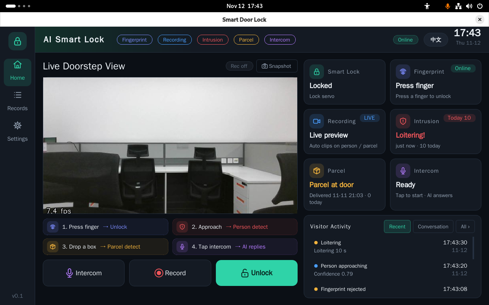

# Smart Door Lock

English | [中文](README_zh.md)

A smart door lock demo for the [Quectel Pi M2](https://www.quectel.com.cn/quectel-pi/documentation-center) single-board computer. It supports camera preview and recording, person and parcel detection, fingerprint unlock, and Coze voice replies.



## Features

- Live camera preview, snapshots, and event-triggered recording
- Person detection (approaching, loitering) and parcel detection, with local NPU inference
- AS608 fingerprint enrollment and recognition; an SG90 servo performs lock and unlock
- Voice intercom answered by a Coze agent
- Event log and Chinese/English UI; vision, audio, fingerprint, and lock run as independent services

## Hardware Requirements

- Quectel Pi M2 (RK3576)
- USB camera
- Display (HDMI or DSI touchscreen)
- AS608 fingerprint module
- SG90 servo and a separate regulated 5V power supply
- Microphone and speaker (voice intercom)

## Software Environment

- Operating system: Debian 13 (default OS of Quectel Pi, aarch64)
- Backend environment `.venv`: Python 3.11 (installed by uv), matching RKNN Lite 2.3.2
- UI environment `.venv-ui`: system Python 3.13 + PySide6 6.8.3; see [docs/ui-runtime.md](docs/ui-runtime.md) for why it is separate
- Main dependencies: aiohttp, OpenCV, NumPy, cozepy, pyserial, sounddevice, adafruit-circuitpython-fingerprint (full list in [requirements.txt](requirements.txt))
- Voice: a Coze account and API token

## UI Overview

The home page has a left navigation bar, a live view in the middle, and status cards on the right:

| Area | Description |
| --- | --- |
| Top status tags | Color tags for Fingerprint, Recording, Intrusion, Parcel, and Intercom; online status, language switch, and clock on the right |
| Live doorstep view | USB camera preview with frame rate; supports snapshots |
| Action buttons | Intercom, Record, Unlock |
| Status cards | Current state of lock, fingerprint, recording, intrusion, parcel, and intercom |
| Visitor activity | Recent events and conversations, with a view-all option |
| Left navigation | Home, Records, Settings |

Try it in four steps:

1. Enroll a fingerprint in Settings, then press the finger to unlock
2. Approach the door: person detected and recorded
3. Put down a box: parcel detected
4. Tap Intercom: the AI replies by voice

## 1. Preparation

- Quectel Pi M2 (RK3576, ARM64), Debian 13 desktop (system Python 3.13), network, display, keyboard/mouse, and a USB camera. Installation needs sudo for a normal user and enough disk space.
- Fingerprint unlock needs an AS608 module; real unlocking needs an SG90 servo and a separate regulated 5V supply; voice needs a microphone, a speaker, and a Coze account.
- Make sure GitHub, the package sources, and Coze are reachable; the install script downloads dependencies and RKNN Lite. RKNN Lite 2.3.2 must be compatible with the system `librknnrt`.

## 2. Download and Install

Run the following in a desktop terminal on the board as a **normal user** (do not run the whole script with sudo):

```bash
git clone https://github.com/jjking619/smart-door-lock.git
cd smart-door-lock
bash install.sh
```

`Deployment complete` means the installation finished. The script creates the backend `.venv` (Python 3.11) and the UI `.venv-ui` (Python 3.13) without changing the system default Python. It also installs system packages, the CH340/CH341 serial driver, and the Pin33 PWM boot-time permission service, and adds the current user to `dialout`. These steps modify the system but do not start the lock or output servo signals. **Log out and back in after installation** so the serial group permission takes effect; then reopen a terminal and enter the cloned project directory. All commands below run from the project root.

If the driver is missing and the kernel headers do not match, install headers matching the running kernel as the error suggests, or set `KERNEL_HEADERS` and re-run. After a kernel upgrade, run `bash deploy/install_ch341_driver.sh`.

The repository includes the RK3576 person model `models/yolov5s-rk3576.rknn` and the parcel model `models/parcel-yolov5n-rk3576-fp.rknn`. If the person model is missing, the install script tries to copy it from the system image without overwriting existing files.

## 3. Configuration

Installation creates `deploy/systemd/doorlock.env` from [`doorlock.env.example`](deploy/systemd/doorlock.env.example); an existing file is never overwritten. Edit it:

```bash
nano deploy/systemd/doorlock.env
```

- The default is `LOCK_DRIVER=servo`; starting lockd immediately moves the servo to the locked angle. Wire the servo as in section 4 before the first start, and confirm the locked angle is safe with no mechanical load attached.
- For voice, only fill in `COZE_API_TOKEN` obtained from Coze and keep `COZE_MODE=streaming`. The project creates or updates and publishes the agent automatically, then writes `COZE_BOT_ID` back to the config. `COZE_VOICE_ID` may stay empty; empty audio device IDs use the system default. List audio devices with `.venv/bin/python -m sounddevice`. Without voice configuration, start with `--no-audio`.
- The default `VISION_SOURCE=auto` discovers the camera automatically; with several cameras, set the actual `/dev/v4l/by-id/...-video-index0` path. The fingerprint serial port is scanned automatically; if not found, set `FINGERPRINT_SERIAL` to the real port.
- Adjust `VISION_DOORSTEP_POLY` and `VISION_GROUND_POLY` to your camera view. Both data directories default to `data` relative to the project; check for absolute paths when copying a config from another device.
- `VISION_TOKEN` is empty by default while the vision service is reachable over the network; for remote access, set a token and restrict network access.

The config contains secrets: do not commit or share it, and keep `chmod 600 deploy/systemd/doorlock.env`. After filling in the token, run the automatic setup once from the project root (the Coze account must already have a workspace):

```bash
set -a
. ./deploy/systemd/doorlock.env
set +a
.venv/bin/python -m audio.coze_setup --write-env deploy/systemd/doorlock.env
```

The script looks for an agent with the default name "门锁访客助手" and creates it if absent, then publishes it to the API channel, verifies the publish status, and writes `COZE_BOT_ID`. Re-running reuses the same agent. If you do not need Coze or cannot reach it, skip this step and start with `--no-audio`.

## 4. Wiring and First Start

Connect the camera, display, and any audio devices. The AS608 TX/RX use 3.3V TTL levels and must be crossed; make sure the module power meets its specification and shares ground with the board. USB-to-serial devices need `dialout` permission. Connect the SG90 signal wire to **physical Pin33** of the M2, powered by a separate regulated 5V supply sharing ground with the M2. Do not attach the servo horn or the door's mechanical load before the first start; startup immediately drives the servo to the locked angle (default 0°), so first confirm it will not hit a limit or cause damage.

In a desktop terminal:

```bash
ls -lh models/yolov5s-rk3576.rknn models/parcel-yolov5n-rk3576-fp.rknn
set -a
. ./deploy/systemd/doorlock.env
set +a
.venv/bin/python main.py
```

The launcher starts the vision, audio, fingerprint, and real servo lock services and the desktop UI; without voice configuration, append `--no-audio` to the last line. Confirm the servo moves to a safe locked angle, then test real unlock and re-lock in the UI. Closing the UI stops the services created by this launch. Services already running independently may be reused; do not start the same service in different ways at once. After the terminal exits or you log in again, load the config again.

## 5. Verification

With the UI open, check from another terminal:

```bash
curl -fsS http://127.0.0.1:8083/health
curl -fsS http://127.0.0.1:8084/health  # not running with --no-audio
curl -fsS http://127.0.0.1:8085/health
curl -fsS http://127.0.0.1:8086/health
```

- Vision health should show `detector: "rknn"`; in dual-model mode `package_detector` should also be `"rknn"`, with empty error fields. The UI preview should show video. By default the vision service pauses and releases the camera when there is no UI, preview, or recording; this is normal.
- In lock health, the `driver` field of the `driver` object should be `servo` and `error` should be empty. Once angles are confirmed safe, attach the mechanical load and repeat the test.
- Fingerprint health can be used to check the module connection. Enroll a fingerprint before unlocking (see below).
- For voice, check `talk_available` / `talk_error`, then start an intercom in the UI to verify the microphone, Coze reply, and speaker. A successful health check does not prove cloud quota or the whole voice chain works.
- Watch person and parcel events, recordings, and records under `data/`; detection accuracy and regions need on-site tuning.

### Enroll a Fingerprint

A fingerprint must be enrolled before it can unlock; unregistered templates do not open the door:

1. Open "Settings" in the left navigation and select the fingerprint management tab (make sure the fingerprint service is online).
2. Enter a name (e.g. "Zhang San") and a note (e.g. "right index finger") on the right, then click "Add fingerprint".
3. Follow the prompts: press the same finger on the AS608 twice in the same position, lifting it when prompted.
4. After "enrolled" is shown, a new ID appears in the list; press that finger on the sensor and the home page should show an unlock.
5. On the same tab you can rename, save notes, or delete (deletion needs confirmation and cannot be undone); unlock events appear on the Records page.

If the two presses repeatedly fail to merge, enroll again with the same finger in the same position. Enrollment only registers identity and does not unlock by itself. Templates are stored in the AS608 module; `data/fingerprint/users.json` only stores IDs and names.

## 6. Using the Real Servo

Wire it and calibrate with no mechanical load before the first start: SG90 signal to **physical Pin33** of the M2, ground to GND, power to a separate regulated 5V supply sharing ground with the M2; never power the servo from GPIO/3.3V. Adjust `LOCK_SERVO_LOCKED_ANGLE` and `LOCK_SERVO_UNLOCKED_ANGLE` to your mechanism so it does not hit a limit or stall. The template default is `LOCK_DRIVER=servo`, so no driver switch is needed; start as in section 4 and check lock health and real unlock/re-lock.

The SG90 has no position feedback, so software cannot guarantee re-locking after power loss or a crash. Keep a mechanical emergency way to open the door, and do not rely on software alone for personal safety.

## 7. Optional: systemd Background Services

The install script only generates service files; it does not install or start them. First exit the desktop launcher and any old services on the same ports, confirm `LOCK_DRIVER=servo`, and make sure the servo is calibrated without load with a safe locked angle. Enabling lockd immediately drives the servo to the locked angle. From the project root:

```bash
mkdir -p data
python3 deploy/generate_systemd.py
sudo install -m 644 deploy/systemd/generated/*.service /etc/systemd/system/
sudo systemctl daemon-reload
sudo systemctl enable --now visiond audiood lockd fingerprintd
sudo systemctl status visiond audiood lockd fingerprintd
```

Enable only the services you need. They read the same `doorlock.env`; after editing it, restart the affected services, e.g. `sudo systemctl restart audiood`. View logs with `sudo journalctl -u visiond -u audiood -u lockd -u fingerprintd -n 100 --no-pager`. With the background services running, load the same config in a desktop terminal and run `.venv/bin/python main.py --ui-only`; closing the UI does not stop the systemd services. After moving the project directory or changing the run user, regenerate and reinstall the service files, and avoid enabling same-named user-level services at the same time.

## Project Structure

```
smart-door-lock/
├── assets/                 # README screenshots
├── deploy/                 # Deployment scripts, systemd and config templates
│   └── systemd/            # doorlock.env.example, *.service templates
├── docs/                   # Manual, architecture, design, UI runtime notes
├── models/                 # RKNN models and LICENSE
├── src/
│   ├── application.py      # Unified launcher (called by main.py)
│   ├── vision/             # Vision service (camera, detection, recording)
│   ├── audio/              # Voice service and Coze setup
│   ├── fingerprint/        # Fingerprint service (AS608)
│   ├── lock/               # Lock service and drivers (servo/gpio/mcu/mock)
│   └── ui/                 # PySide6 desktop UI
├── tests/                  # Tests
├── install.sh              # One-step install script
├── main.py                 # Entry point
├── pyproject.toml
├── requirements.txt
└── LICENSE
```

## Model Overview

The vision service runs two RKNN models in parallel, on NPU Core0 and Core1 of the RK3576:

- **Person model** `yolov5s-rk3576.rknn`: YOLOv5s (COCO); only person detections are kept.
- **Parcel model** `parcel-yolov5n-rk3576-fp.rknn`: a dedicated YOLOv5n with classes `defect-parcel` and `good-parcel`, from the public [parcel detection weights](https://github.com/Y47ya/parcels-object-detection-and-classification-Yolov5), converted to an unquantized RKNN.

Models cannot be swapped by only renaming files; see [src/vision/README.md](src/vision/README.md). Models are used under their own upstream licenses; see [models/LICENSE](models/LICENSE).

## License

The project code is released under the [Apache License 2.0](LICENSE).

## Reporting Issues

If you run into problems, please submit technical inquiries on the [Quectel Official Forum](https://forumschinese.quectel.com/c/quectel-pi/58). Issues and Pull Requests are welcome.

## Notes

- To keep detecting without a UI, set `VISION_PAUSE_WITHOUT_UI=0` and restart the vision service.
- Fingerprint management needs no PIN; recordings and events are stored in `data/`, so mind access permissions, disk space, and backups.
- A successful installation per this README does not mean real hardware, network, model accuracy, or Coze quota has been verified.
