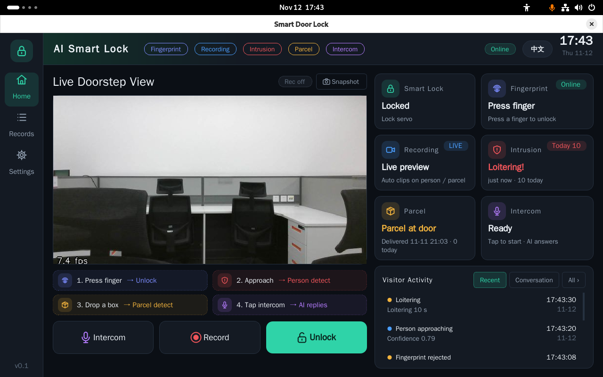

# 智能门锁

[English](README.md) | 中文

基于 Quectel Pi M2 智能主控板的智能门锁示例，支持摄像头预览与录像、
人员和包裹检测、指纹开锁及 Coze 语音应答。



## 功能特性

- 摄像头实时预览、抓拍与事件触发录像
- 人员检测（接近、徘徊）与包裹检测，NPU 本地推理
- AS608 指纹录入与识别开锁，SG90 舵机执行开回锁
- Coze 智能体语音对讲应答
- 事件记录、中英文界面切换；视觉、音频、指纹、锁体各为独立服务

## 硬件要求

- Quectel Pi M2 智能主控板
- USB 摄像头
- 显示器（HDMI 或 DSI 触摸屏）
- AS608 指纹模块
- SG90 舵机及独立稳压 5V 电源
- 麦克风与扬声器（语音对讲）

## 软件环境

- 操作系统：Debian 13（Quectel Pi 默认系统，aarch64）
- 后端环境 `.venv`：Python 3.11（由 uv 安装），与 RKNN Lite 2.3.2 匹配
- 界面环境 `.venv-ui`：系统 Python 3.13 + PySide6 6.8.3，原因见 [docs/ui-runtime.md](docs/ui-runtime.md)
- 主要依赖：aiohttp、OpenCV、NumPy、cozepy、pyserial、sounddevice、
  adafruit-circuitpython-fingerprint（完整列表见 [requirements.txt](requirements.txt)）
- 语音：Coze 账号及 API Token

## 功能与界面

主界面（首页）由左侧导航、中间实时画面和右侧状态卡片组成：

| 区域 | 说明 |
| --- | --- |
| 顶部状态标签 | 指纹、录像、闯入、包裹、对讲各功能的颜色标识，右侧为在线状态、中英文切换与时钟 |
| 实时门前画面 | USB 摄像头预览，显示帧率；支持抓拍（Snapshot） |
| 操作按钮 | 对讲（Intercom）、录像（Record）、开锁（Unlock） |
| 状态卡片 | 智能锁、指纹、录像、闯入、包裹、对讲的当前状态 |
| 访客动态 | 最近事件与对话记录，可查看全部 |
| 左侧导航 | 首页、记录（Records）、设置（Settings） |

体验流程 ：

1. 在设置中录入指纹，随后按压指纹 → 开锁
2. 人员靠近 → 人员检测并录像
3. 放下包裹 → 包裹检测
4. 点击对讲 → AI 语音应答

## 1. 准备

- Quectel Pi M2（RK3576，ARM64）、Debian 13 桌面系统（系统 Python 3.13）、
  网络、显示器、键鼠及 USB 摄像头；安装需要普通用户的 sudo 权限和足够磁盘空间。
- 指纹开锁还需 AS608 指纹模块；实际开锁需 SG90 舵机及独立稳压 5V 电源；
  语音需麦克风、扬声器和 Coze 账号。
- 确认可访问 GitHub、软件源和 Coze；安装脚本会联网下载依赖及 RKNN Lite。
  RKNN Lite 2.3.2 与系统 `librknnrt` 须兼容。

## 2. 下载并安装

在板子的桌面终端中，以**普通用户**运行（不要对整个脚本使用 sudo）：

```bash
git clone https://github.com/jjking619/smart-door-lock.git
cd smart-door-lock
bash install.sh
```

出现 `Deployment complete` 表示安装完成。脚本创建后端 Python 3.11 的 `.venv`
和界面 Python 3.13 的 `.venv-ui`，不修改系统默认 Python；还会安装系统依赖、
CH340/CH341 串口驱动、Pin33 PWM 开机授权服务，并将当前用户加入 `dialout`。
这些步骤会修改系统，但不会启动门锁或输出舵机波形。**安装后注销并重新登录**，
使串口组权限生效；重新打开终端后进入克隆的项目目录，以下命令均从项目根目录执行。

如果驱动缺失且内核头文件不匹配，按报错安装与当前内核匹配的头文件，或设置
`KERNEL_HEADERS` 后重新运行；内核升级后可运行 `bash deploy/install_ch341_driver.sh`。

仓库包含 RK3576 人员模型 `models/yolov5s-rk3576.rknn` 和包裹模型
`models/parcel-yolov5n-rk3576-fp.rknn`。人员模型缺失时安装脚本尝试从系统镜像
复制，不覆盖已有文件；

## 3. 配置

安装时会从 [`doorlock.env.example`](deploy/systemd/doorlock.env.example)
创建 `deploy/systemd/doorlock.env`，已有文件不会被覆盖。编辑该文件：

```bash
nano deploy/systemd/doorlock.env
```

- 默认 `LOCK_DRIVER=servo`，启动 lockd 会立即将舵机转到回锁角度。首次启动前按第 4节接好舵机，并在无机械负载状态下确认回锁角度安全。
- 语音只需先填写从 Coze 获取的 `COZE_API_TOKEN`，保持 `COZE_MODE=streaming`。
  项目会自动创建或更新并发布智能体，再将 `COZE_BOT_ID` 写回配置；
  `COZE_VOICE_ID` 可留空，音频设备号留空则使用系统默认设备。
  可用 `.venv/bin/python -m sounddevice` 查看音频设备。没有配置语音时可先用 `--no-audio`。
- 默认 `VISION_SOURCE=auto` 自动发现摄像头；多个摄像头时可改为实际的
  `/dev/v4l/by-id/...-video-index0` 路径。指纹串口自动扫描，未找到时将
  `FINGERPRINT_SERIAL` 设为实际串口路径。
- 按摄像头实际画面调整 `VISION_DOORSTEP_POLY`、`VISION_GROUND_POLY`。
  两项数据目录默认均为相对项目目录的 `data`；从其他设备复制配置时检查绝对路径。
- `VISION_TOKEN` 默认留空，而视觉服务可从网络访问；需要远程访问时设置令牌并限制网络访问。

配置含密钥，不要提交或分享；确保权限为 `chmod 600 deploy/systemd/doorlock.env`。
填好 Token 后，在项目根目录运行一次自动初始化（需要 Coze 账号下已有工作空间）：

```bash
set -a
. ./deploy/systemd/doorlock.env
set +a
.venv/bin/python -m audio.coze_setup --write-env deploy/systemd/doorlock.env
```

脚本会按默认名称“门锁访客助手”查找同名智能体；未找到时创建；之后发布到 API 渠道、验证发布状态，并写入 `COZE_BOT_ID`。
重复运行会复用同名智能体，不会重复创建。若语音不需要 Coze 或暂时无法访问 Coze，
跳过这一步，并在启动时使用 `--no-audio`。

## 4. 接线与首次启动

连接摄像头、显示器和所需音频设备。AS608 的串口 TX/RX 使用 3.3V TTL 电平并交叉连接，
确保模块供电符合其规格并与主控共地；USB 转串口设备需要 `dialout` 权限。
SG90 信号线接 M2 **物理 Pin33**，使用独立稳压 5V 电源并与 M2 共地。首次启动前先不要
连接舵机摇臂或门锁机械负载；启动会立即驱动舵机到回锁角度（默认 0°），应先确认不会
碰到限位或造成损坏。

在桌面终端中运行：

```bash
ls -lh models/yolov5s-rk3576.rknn models/parcel-yolov5n-rk3576-fp.rknn
set -a
. ./deploy/systemd/doorlock.env
set +a
.venv/bin/python main.py
```

启动器会启动视觉、音频、指纹和真实舵机锁体服务及桌面界面；若没有语音配置，在最后一行
追加 `--no-audio`。先确认舵机移动到安全的回锁角度，再在界面测试实际开锁和回锁。
关闭界面会停止由本次启动器创建的服务。已独立运行的服务可能被复用；
不要同时用不同方式启动同一服务。
终端退出或重新登录后需重新加载配置。


## 5. 验证

保持界面打开，在另一个终端检查：

```bash
curl -fsS http://127.0.0.1:8083/health
curl -fsS http://127.0.0.1:8084/health  # 使用 --no-audio 时不运行
curl -fsS http://127.0.0.1:8085/health
curl -fsS http://127.0.0.1:8086/health
```

- 视觉健康信息应显示 `detector: "rknn"`；双模型模式下
  `package_detector` 也应为 `"rknn"`，且对应错误字段为空。界面预览应能看到画面；
  默认没有界面、预览或录像时视觉服务会暂停并释放相机，这是正常现象。
- 锁体健康信息中 `driver` 对象的 `driver` 字段应为 `servo`，且 `error` 为空；
  角度确认安全后，再连接机械负载并重复测试。
- 指纹服务的健康信息可用于检查模块连接。开锁前须先录入指纹（见下）。
- 语音服务检查 `talk_available` / `talk_error`，再在界面发起对讲，实际验证
  麦克风、Coze 应答和扬声器。健康接口成功不代表云端额度或整个语音链路可用。
- 观察人员和包裹事件、录像与 `data/` 中的记录；检测精度和区域需现场调试。

### 录入指纹

指纹须先录入才能开锁，未登记的模板不会开门：

1. 界面左侧进入“设置”，打开“指纹管理”页签（需先确认指纹服务在线）。
2. 在右侧填写姓名（如“张三”）和备注（如“右手食指”），点击“添加指纹”。
3. 按界面提示，用同一手指在同一位置按压 AS608 两次，每次提示移开后再按。
4. 显示“录入成功”后，列表出现新编号；将该手指按在传感器上，首页应显示开锁。
5. 可在同一页签改名、保存备注或删除（删除需确认且不可恢复）；开锁事件见“记录”页。

两次按压多次无法合并时，请用同一手指、相同位置重新录入。录入只登记身份，本身不会开锁。
指纹模板存放在 AS608 模块中，`data/fingerprint/users.json` 仅保存编号和姓名。

## 6. 使用实际舵机

首次启动前接线并在无机械负载时校准：SG90 信号线接 M2 **物理 Pin33**，
地线接 GND，电源线接独立稳压 5V 电源，电源与 M2 共地；不要用 GPIO/3.3V 给舵机供电。
按实际结构调整 `LOCK_SERVO_LOCKED_ANGLE` 和 `LOCK_SERVO_UNLOCKED_ANGLE`，
确认不会顶住限位或堵转。模板默认 `LOCK_DRIVER=servo`，无需切换驱动；按第 4 节启动，
检查锁体健康信息及实际开锁、回锁。

SG90 没有位置反馈，断电或进程崩溃时软件无法保证回锁，须保留机械应急开门方式；
不要仅依赖软件保障人身安全。

## 7. 可选：systemd 后台服务

安装脚本只生成服务文件，不会自动安装或启动它们。先退出桌面启动器及同端口的旧服务，
并确认配置为 `LOCK_DRIVER=servo`，且舵机已经在无负载下校准、回锁角度安全。启用 lockd
时会立即驱动舵机到回锁角度。从项目根目录执行：

```bash
mkdir -p data
python3 deploy/generate_systemd.py
sudo install -m 644 deploy/systemd/generated/*.service /etc/systemd/system/
sudo systemctl daemon-reload
sudo systemctl enable --now visiond audiood lockd fingerprintd
sudo systemctl status visiond audiood lockd fingerprintd
```

只需部分功能时可只启用所需服务。服务读取同一个 `doorlock.env`；
修改后需重启受影响的服务，例如 `sudo systemctl restart audiood`。
查看日志：`sudo journalctl -u visiond -u audiood -u lockd -u fingerprintd -n 100 --no-pager`。
启动后台服务后，桌面终端可加载同一配置，再运行 `.venv/bin/python main.py --ui-only`；
界面关闭不会停止 systemd 服务。移动项目目录或更换运行用户后重新生成并安装服务文件，
避免与用户级同名服务同时启用。

## 项目结构

```
smart-door-lock/
├── assets/                 # README 截图
├── deploy/                 # 部署脚本、systemd 模板与配置模板
│   └── systemd/            # doorlock.env.example、*.service 模板
├── docs/                   # 使用手册、架构、设计与界面运行时说明
├── models/                 # RKNN 模型及 LICENSE
├── src/
│   ├── application.py      # 统一启动器（main.py 调用）
│   ├── vision/             # 视觉服务（摄像头、检测、录像）
│   ├── audio/              # 语音服务与 Coze 初始化
│   ├── fingerprint/        # 指纹服务（AS608）
│   ├── lock/               # 锁体服务与驱动（servo/gpio/mcu/mock）
│   └── ui/                 # PySide6 桌面界面
├── tests/                  # 测试
├── install.sh              # 一键安装脚本
├── main.py                 # 启动入口
├── pyproject.toml
├── requirements.txt
└── LICENSE
```

## 模型概述

视觉服务并行运行两个 RKNN 模型，分别占用 RK3576 的 NPU Core0 / Core1：

- **人员模型** `yolov5s-rk3576.rknn`：YOLOv5s（COCO），只保留人员检测结果。
- **包裹模型** `parcel-yolov5n-rk3576-fp.rknn`：专用 YOLOv5n，类别为
  `defect-parcel`、`good-parcel`，来自公开的
  [包裹检测权重](https://github.com/Y47ya/parcels-object-detection-and-classification-Yolov5)，
  转换为未量化 RKNN。

模型不是仅改文件名即可替换，详见 [src/vision/README.md](src/vision/README.md)。
模型按各自上游许可证使用，见 [models/LICENSE](models/LICENSE)。

## 许可证

项目代码使用 [Apache License 2.0](LICENSE)。

## 问题反馈

使用中遇到问题，请到 [Quectel 官方论坛](https://forumschinese.quectel.com/c/quectel-pi/58)
提交技术咨询，也欢迎提交 Issue 和 Pull Request。

## 注意事项

- 如需无界面时持续检测，将 `VISION_PAUSE_WITHOUT_UI=0`，并重启视觉服务。
- 指纹管理无需 PIN；录像和事件保存在 `data/`，请注意访问权限、磁盘空间和备份。
- 本 README 的安装成功不代表真实硬件、网络、模型精度或 Coze 配额已验证。
