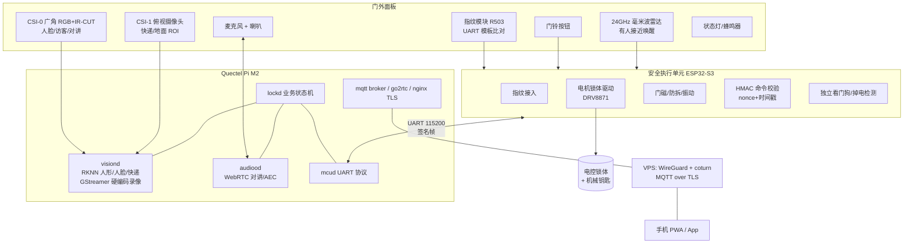
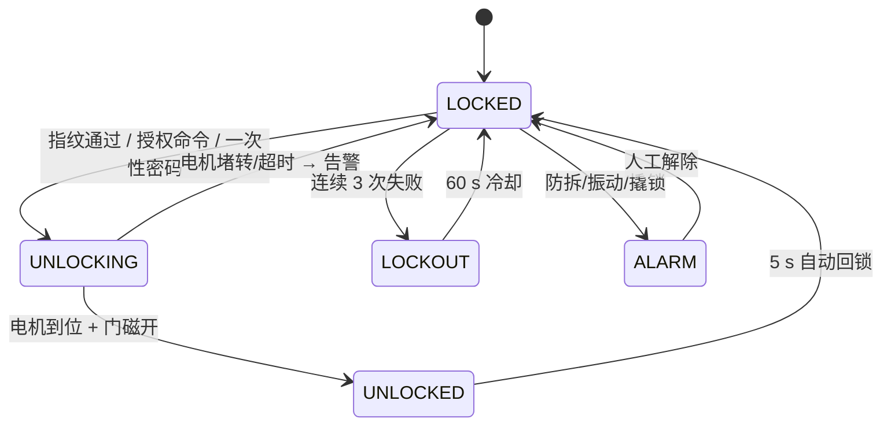

# DIY 智能门锁方案（Quectel Pi M2 / RK3576）

> **当前实施范围（第一阶段）**：摄像头录制/在线查看、入侵检测、快递识别、语音对讲。
> 指纹开锁与锁体控制留到第二阶段（见 §4 状态机），本阶段所有代码**不依赖锁体即可开发测试**。
> 对话/智能应答**只用 Coze**（coze.cn），不再引入百炼。
>
> 主控：Quectel Pi M2（RK3576，4×A72 + 4×A53，6 TOPS NPU，4 GB LPDDR4X + 64 GB eMMC，双 MIPI CSI，USB Type-C 供电，Debian ARM64）。

---

## 1. 三条设计铁律

1. **开锁不能依赖 Linux。** 门锁是安全设备，M2 会死机、掉电、被远程攻击。指纹比对、锁体驱动、门磁、防拆必须由一颗独立 MCU 完成；M2 只做"AI + 网络 + 交互"，挂掉时门锁仍可按指纹/机械钥匙正常使用。
2. **M2 不装在门外。** 门外只放摄像头、麦克风、指纹头、门铃按钮；主控、电源、备用电池放在门内侧或门框上方吊顶，排线走门轴过线器。这样防拆、防雨、防盗、防高温。
3. **先做"能用"，再做"好用"。** 第一版用现成模块（UART 指纹、UVC/MIPI 相机、USB 声卡、ESP32），把机械结构和电源打通；算法和 App 后置。门锁机械改造失败的概率远高于软件。

---

## 2. 系统架构



### 职责划分

| 模块 | 负责 | 不允许做 |
| --- | --- | --- |
| MCU（ESP32-S3） | 指纹比对、开锁驱动、门磁、防拆、振动、雷达、按键、掉电保持 | 联网、跑算法、存人脸 |
| M2 | 视频、AI 推理、对讲、事件规则、存储、云端同步、UI | 直接驱动锁体、直接读指纹模板 |
| 云端/VPS | 穿透、TURN、推送、远程回放 | 保存原始人脸/指纹 |

---

## 3. 硬件选型（BOM）

| # | 部件 | 推荐型号 | 参考价 | 说明 |
| --- | --- | --- | --- | --- |
| 1 | 主控 | Quectel Pi M2 | 已有 | 双 CSI 是快递识别方案的硬件基础 |
| 2 | 安全 MCU | ESP32-S3-WROOM-1（或 ESP32-C6 以便后续 Matter） | ¥30 | 双核 240 MHz，自带 Wi-Fi/BLE 备份通道 |
| 3 | 指纹 | R503 / FPM383C（电容式，UART） | ¥60–90 | **模板存储+比对在模块内**，断网可用；带金属防静电环 |
| 4 | 门外摄像头 | MIPI CSI IMX219/OV5647 + IR-CUT + 2×850 nm 补光 | ¥120 | 优先买移远官方兼容的 CSI 模组，DTS 免折腾；否则用 USB UVC |
| 5 | 俯视摄像头 | 同上，或用 120° 广角 USB UVC | ¥60–120 | 看门口地面，快递识别专用 |
| 6 | 音频 | I2S MEMS 麦 ×2 + MAX98357A + 3 W 8 Ω 喇叭 | ¥40 | 对讲必须做 AEC，否则啸叫 |
| 7 | 雷达 | HLK-LD2410C（24 GHz，UART） | ¥30 | 有人接近才唤醒摄像头，省电 + 隐私友好 |
| 8 | 锁体 | 6068 电机锁体（12 V 脉冲）+ 机械钥匙 | ¥150–300 | 断电自动保持锁定（fail-secure），带机械应急 |
| 9 | 电机驱动 | DRV8871 / BTS7960 | ¥15 | 加 1000 µF 电容吸收浪涌 |
| 10 | 门磁/防拆 | 干簧管 + 微动开关 + MPU6050 | ¥20 | 撬锁/拆面板/贴门震动 |
| 11 | 电源 | 12 V/3 A 适配器 → 12 V 给电机、DCDC 5 V/3 A 给 M2 | ¥60 | **M2 必须稳定 5 V/3 A，Type-C 供电不能靠电池直供** |
| 12 | UPS | 18650 ×2 + 充放电管理 + 12 V 升压 | ¥90 | 掉电时 MCU 继续工作数周，M2 优雅关机 |
| 13 | 安全元件（可选） | ATECC608A / SE050 | ¥15 | 存私钥，做 mTLS 与固件签名校验 |
| 14 | 面板/结构 | 亚克力 + 铝合金门内盒 + 门轴过线器 | ¥100 | 门外面板做防水灌胶，摄像头开孔加遮光筒 |

**合计约 ¥800–1400（不含 M2）。**

### 供电与走线要点

- 门内取市电 → 12 V/3 A 适配器 → 分三路：电机（12 V）、M2（5 V/3 A）、MCU+传感器（5 V/0.5 A，经 UPS）。
- 门到门框用**过线器/铰链过线**，不要用无线传电（不可靠）。
- 电机动作 100–300 ms、峰值 1–2 A，与 M2 共用电源时必须加大电容并做 Star 接地，否则 M2 会被拉复位。
- 应急：门外预留 9 V 电池触点 + 机械钥匙孔。

---

## 4. 软件架构（M2 端）

Debian ARM64 + systemd（或 docker compose + `--device /dev/rknpu`）。服务拆分：

| 服务 | 技术栈 | 职责 |
| --- | --- | --- |
| `mcud` | Python asyncio + pyserial | UART 帧编解码、心跳、签名校验、事件上抛 |
| `visiond` | Python 3.11 + RKNN-Toolkit-Lite2 2.3.2 + OpenCV + GStreamer(rkmpp) | 推理、环形缓冲、事件录像、抓拍 |
| `audiood` | sounddevice/aiortc + webrtc-audio-processing(AEC3) + **Coze 工作流** + 本地 sherpa-onnx | 门铃呼叫、双向对讲、自动应答（详见 §5.6） |
| `lockd` | FastAPI + MQTT | 状态机、规则引擎、REST/WebSocket API |
| `go2rtc` | 单二进制 | WebRTC/HLS 实时预览，低延迟 <300 ms |
| `mosquitto` / `nginx` | — | 本地事件总线 / TLS 反代 + 静态 PWA |

**事件总线**：所有模块只发 JSON 事件到 MQTT（`lock/event/#`），`lockd` 统一落库（SQLite + WAL）并决定通知/录像/告警。这样加功能不用改核心。

```json
{
  "ts": "2026-11-02T15:44:10.123+08:00",
  "type": "person.detected",
  "source": "visiond",
  "conf": 0.93,
  "zone": "doorstep",
  "snapshot": "/data/events/20261102/154410.jpg",
  "clip": "/data/events/20261102/154410.mp4"
}
```

### M2 ↔ MCU 协议

帧：`AA 55 | ver | cmd | seq | len | payload | crc16`

| 方向 | 命令 | 载荷 | 说明 |
| --- | --- | --- | --- |
| M2→MCU | `UNLOCK` | userId, method, ts, nonce, HMAC-SHA256 | MCU 校验时间窗 ±5 s + nonce 去重，防重放 |
| M2→MCU | `LOCK` / `STATUS` / `CONFIG` | — | 心跳 2 s，超时 10 s 自动保持锁定 |
| MCU→M2 | `FINGER_MATCH` | id, score | 指纹开锁由 MCU 决策，只上报 |
| MCU→M2 | `DOOR_OPENED/CLOSED` | — | 门磁状态变化 |
| MCU→M2 | `TAMPER` / `VIBRATION` / `LOW_BATTERY` / `MOTOR_FAULT` | — | 告警事件 |

**关键**：UART 加光耦/电平隔离 + TVS，防止"电击开锁"和外部高压注入。

### 开锁状态机



---

## 5. 五大功能实现要点

### 5.1 指纹识别

- **匹配在 R503 内部完成**（200 枚模板），MCU 收到 matchID 后直接开锁，M2 只做日志与抓拍（开锁瞬间拍一张存档，可选）。
- 录入/删除：手机端发起 → M2 → MCU → 指纹模块；录入需在门内按物理确认键，防远程恶意录入。
- 失败策略：3 次失败锁 60 s；指纹头断线 = 只能机械钥匙 + 立即报警。
- 加分项：指纹 + 密码/人脸"双因子"模式，用于高安全场景。

### 5.2 摄像头录像 / 在线查看

- **不 24 h 常开**：雷达/门铃/门磁触发 → 摄像头启动（MIPI 约 200–400 ms）→ 预热 2 s → 录像。
- **环形缓冲 pre-roll 10 s**：GStreamer 双队列 + 环形文件，事件发生时把"事发前 10 s"一起落盘，证据完整。
- 硬编码：`mpph264enc` / `mpph265enc`（RK3576 有 VPU，CPU 几乎零占用），1080p@25、2 Mbps。
- 存储策略：只存事件片段（30 s 片段 × 50 次/天 ≈ 3 GB/天），7 天循环；需要 24 h 录像再加 USB SSD。
- 远看：`go2rtc` 出 WebRTC（首帧 <1 s、延迟 <300 ms）和 HLS 兜底；PWA 内嵌 `<video>`。
- 夜视：IR-CUT 由光敏 + MCU GPIO 控制，补光用 850 nm（肉眼弱红暴）或 940 nm（完全无红暴，但灵敏度低）。

### 5.3 入侵检测

**不要用"移动侦测"**，误报会毁掉体验。分层规则：

| 层 | 手段 | 作用 |
| --- | --- | --- |
| 触发 | LD2410C 雷达 + PIR | 有人接近才启动视觉，省电且不拍空楼道 |
| 检测 | YOLOv8n/YOLO11n RKNN 人形检测 @640，30–60 FPS | 区分人 / 猫 / 树影 |
| 定位 | ROI 多边形 + 停留计时 | 只关心门口区域，排除公共走廊（隐私遮罩同步生效） |
| 语义 | 人脸识别（ArcFace MobileFaceNet）+ 时段 + 门磁状态 | 家人/授权人 → 忽略；陌生人夜间停留 > 10 s → 告警 |
| 物理 | 门磁、MPU6050 振动、防拆微动、麦克风异常声（撬锁/钻孔） | 摄像头被遮挡也能报警 |

告警动作：预录片段上传 + 手机推送 + 本地蜂鸣/语音警告（"已录像"对震慑很有效）+ 可选联动室内灯。

### 5.4 快递识别

- **硬件前提**：第二路 CSI 俯拍门口地面（这是 M2 双 CSI 的最大价值）。
- 算法：YOLO 自定义 `package/box/bag` 类（COCO 的 `suitcase` 可冷启动，再用 200–500 张自采图微调，RKNN 量化后 6 TOPS 足够 30 FPS）。
- 判定逻辑（关键是"时序"而非单帧）：
  1. 检测到人形进入 ROI；
  2. 人形离开 ROI 且 20 s 内未返回；
  3. 地面 ROI 出现**新的静止物体**（跟踪框 IoU/位置稳定 ≥ 10 s）；
  4. 门磁未开、无人脸授权 → 判定为"疑似快递"。
- 输出：物品快照 + 放置时间 + 短视频，推送"门口有包裹"。
- 防误报：鞋子/地垫/雨伞用类别白名单过滤；同一位置 5 min 内只报一次。

### 5.5 语音对讲

- 链路：门铃 → M2 发起 WebRTC 呼叫 → 手机 PWA 响铃（Web Push / Bark / 企业微信机器人兜底）→ 接通后双向 Opus 48 kHz。
- **AEC 是成败关键**：用 `webrtc-audio-processing`（AEC3）+ RNNoise，麦克风与喇叭做物理隔离（间距 > 8 cm，加防震棉）。
- 无人接听 20 s → 本地 TTS 自动应答 + 录音留言。
- 对讲时同步录像（WebRTC 与 GStreamer 各自取流，注意 CSI 带宽，必要时降预览分辨率）。
- 云端：自建 VPS 跑 coturn（TURN over TLS 443），或 Tailscale/WireGuard 组网，**不要做端口映射暴露 RTSP**。
- 语音识别/合成：见 §5.6，音频走「本地优先 + Coze 兜底」双通道。

### 5.6 语音链路分层（Coze 单栈方案）

门铃按下后的处理分成三条**互不阻塞**的通路，任何一条挂掉都不影响其他：

```
门铃按下
├─ 通路 A 对讲主体：WebRTC 直连手机（不经任何 AI 云）        ← 延迟 <300 ms
├─ 通路 B 本地兜底：TTS 播报 + 录音留言（sherpa-onnx）        ← 断网可用，0 延迟
└─ 通路 C 智能应答：本地 ASR → Coze 工作流 → 本地 TTS         ← 4 级兜底
```

**通路 C 的调用顺序（每一级都有超时，总计不超过 2 s 出声）：**

| 级别 | 组件 | 超时 | 失败后 |
| --- | --- | --- | --- |
| 1 | Coze 工作流（`CozeWorkflowClient.ask`） | 6 s，重试 1 次 | 熔断 60 s，进下一级 |
| 2 | 本地小模型（可选，`local_reply` 回调） | 2 s | 进下一级 |
| 3 | 固定话术（"主人不在，请留言"） | 0 | — |
| 4 | 静默超时提示 | — | — |

**Coze 工作流的输入 / 输出契约（必须在 Bot 提示词里锁死）：**

入参：`text`（访客话术）、`history`（最近 6 轮）、`event`（`doorbell`/`motion`/`package`）、`zone`

出参：**纯 JSON，不许 markdown 围栏、不许自然语言包裹**

```json
{ "reply": "好的，我帮您通知主人。", "action": "notify_owner", "args": { "urgency": "normal" } }
```

`action` 白名单：`reply_only` / `notify_owner` / `leave_message` / `request_unlock`。

**`request_unlock` 的铁律**：Coze 只能"提出请求"，`needs_local_auth` 恒为 `True`，最终是否开锁由 `lockd` 校验（白名单用户 + 时间窗 + HMAC 签名）后下发 MCU 决定。模型输出里的 `authorized` / `is_owner` 字段一律丢弃（`coze_client.py` 已实现）。**不要让大模型成为最后一道开锁关口。**

**ASR / TTS 选型（不绑定厂商）：**

| 环节 | 组件 | 说明 |
| --- | --- | --- |
| ASR | **Coze** `audio.transcriptions.create`（文件）/ `websockets.audio.transcriptions`（流式） | wav/ogg/mp3，≤10 MB、≤30 min，按音频时长计费 |
| 对话 | **Coze Workflow** | 编排改需求不用发版 |
| TTS | **Coze** `audio.speech.create` | 支持 wav/pcm/ogg_opus/mp3，采样率可选 8k–48k |

> 更正上一版说法：Coze 开放平台确实提供**独立的**语音识别与语音合成接口（`cozepy>=0.20`），
> 不必再接 SiliconFlow 之类的第三方 ASR/TTS。整套"只用 Coze"是成立的：
> `audio.transcriptions` → `workflows.runs` → `audio.speech`，一个 token 全搞定。
>
> 两点必须提前知道：
> 1. **计费**：ASR/TTS 按音频时长/字符计费；实时房间（`audio.rooms.create`，走火山 RTC）
>    按通话时长计费，**进房即开始计费**，空等 3 分钟也收费。实验阶段不要反复建房间。
> 2. **实时全双工**不是普通 HTTP：`audio.rooms` 需要端上接火山 RTC SDK，
>    门锁这种场景用「按键说话 + 文件级 ASR/TTS」更省钱也更好调试。

---

## 6. 安全设计清单（门锁的核心）

- [ ] MCU 只接受 HMAC-SHA256 签名命令，带时间戳 + 一次性 nonce，防重放。
- [ ] UART 光耦隔离 + TVS 管，金属面板接地，防高压电击开锁。
- [ ] 固件安全启动（RK3576 支持）+ 固件签名 OTA + A/B 分区回滚。
- [ ] eMMC 关键分区 LUKS 加密；人脸特征向量加密存储，绝不存原始人脸图。
- [ ] mTLS + MQTT ACL，一机一证书；云端只做转发，不存生物特征。
- [ ] 一次性/临时密码用离线 TOTP 变体（30 s 或单次有效），防重放。
- [ ] 开锁全程审计日志（谁、何时、何种方式、是否远程），日志可导出。
- [ ] 物理：防拆开关、离门报警、机械钥匙、9 V 应急供电、防小黑盒（金属屏蔽壳）。
- [ ] 消防：电磁锁必须 fail-safe 并接消防联动；入户门推荐 fail-secure 电控锁体 + 机械钥匙。
- [ ] 隐私：摄像头工作指示灯（法规硬性要求）、公共区域 ROI 遮罩、访客可关闭录像、本地优先存储。

---

## 7. 远程访问与推送（低成本可靠组合）

```
门锁 M2 ──WireGuard/Tailscale──> VPS(2C4G) ──coturn/443──> 手机 PWA
         └──MQTT over TLS(mTLS)──┘
```

- 不开放任何入站端口；用 WireGuard 组网 + TURN 中继解决 NAT。
- 推送优先级：Web Push（PWA，免费）→ Bark/Telegram/企业微信机器人（5 分钟接入，最稳）→ APNs（需证书，最后做）。
- 云存：可只上传事件快照与 10 s 片段到对象存储，24 h 后自动删除。

---

## 8. 里程碑

| 阶段 | 内容 | 验收标准 |
| --- | --- | --- |
| W1 | 锁体测试台（木板模拟门）+ ESP32 固件 + 指纹开锁 + 门磁 | 断网、断 M2 时指纹仍可开锁 |
| W2 | M2 系统 + 摄像头 + GStreamer 录像 + 本地网页预览 | 局域网内 <1 s 出画面，事件片段带前 10 s |
| W3 | RKNN 人形/人脸 + 入侵规则 + 告警推送 | 白天误报 <1 次/天 |
| W4 | 第二路俯拍 + 快递模型微调 + 对讲 WebRTC | 包裹识别准确率 >85%，对讲无明显回声 |
| W5 | 装门 + 电源/UPS + 安全加固 + 7 天老化 + 隐私合规 | 连续 7 天无宕机、无误开锁 |

---

## 9. 主要风险与对策

| 风险 | 对策 |
| --- | --- |
| M2 双 CSI 模组兼容性/DTS 适配 | 优先买移远官方配件；备选 USB UVC（即插即用，代价是占 CPU） |
| 电机浪涌导致 M2 复位 | 电机独立供电 + 大电容 + 光耦隔离 + star 接地 |
| 门体开孔/走线破坏门 | 先在木板测试台验证 2 周，再上真门；用门轴过线器 |
| AEC 效果差、啸叫 | 麦克风远离喇叭、加防震棉、用 AEC3 + 限幅，必要时换 USB 会议全向麦 |
| NPU 模型精度不足 | 先跑官方 RKNN 模型 demo，自采数据微调；快递用"时序 + 静止物体"补足 |
| 隐私投诉（拍到邻居） | 安装角度朝向自家门口、ROI 遮罩、指示灯、本地存储、可关闭 |

---

## 10. 可复用的现有代码

工作区中 `AURA-Desktop-AR-Companion-System` 已经跑通并验证了 RK3576 上的：

- `aura_app/backend/camera.py`：单线程相机管理 + JPEG 预览 + 预览客户端释放（可直接改造成 visiond 的取流层）。
- `aura_app/backend/gesture_rknn.py` 与 `models/rknn/`：RKNN-Toolkit-Lite2 2.3.2 在 RK3576 上的推理封装与模型加载方式（换成 YOLO/SCRFD 即可）。
- `aura_app/backend/voice.py`：**只复用音频采集/播放与流式处理骨架**，ASR/TTS 换成 §5.6 的本地 + Coze 方案（不再依赖百炼）。
- `aura_app/backend/sound_direction.py`：麦克风阵列声源定位（可用于判断声音来自门口哪一侧）。
- 前端 React + Vite + Tailwind 工程结构（改造成手机 PWA 控制台）。

新仓库结构（`audiood` 已先行落地）：

```
smart-door-lock/
├── docs/                 # 本方案
├── firmware/mcu/         # ESP32-S3 固件（指纹/锁体/门磁/协议）
├── device/               # M2 端 systemd 服务
│   ├── lockd/            # FastAPI 状态机 + 规则引擎
│   ├── visiond/          # RKNN 推理 + GStreamer 录像
│   ├── audiood/          # ✅ 对讲/自动应答（Coze 链路已实现）
│   │   ├── coze_client.py      # 工作流客户端 + 熔断 + 4 级兜底
│   │   ├── coze_smoke_test.py  # 连通性自检
│   │   └── app.py              # 录音 → 应答 → 播报主循环
│   └── mcud/             # UART 协议
├── models/               # RKNN 模型与转换脚本
├── web/                  # PWA 控制台
├── deploy/               # systemd/docker/nginx/coturn 配置
└── hardware/             # 原理图、接线表、面板开孔图
```

### 10.1 起步顺序（只做这四项：录像 / 入侵 / 快递 / 对讲）

| 步骤 | 产出 | 依赖 | 可独立验证 |
| --- | --- | --- | --- |
| 1 | `visiond`：取流 + 环形缓冲 + 事件片段 | 摄像头跑通 `v4l2-ctl`/GStreamer | `ffplay` 能放，片段含前 10 s |
| 2 | `visiond`：YOLO 人形检测 + ROI 规则 | RKNN 模型转换成功 | 事件 JSON 正确、误报统计 |
| 3 | `visiond`：第二路俯拍 + 快递时序判定 | CSI-1 可用 | 放置包裹能触发一次 |
| 4 | `audiood`：Coze 连通 → 本地 ASR/TTS → WebRTC | 麦克风/喇叭 | 门铃 2 s 内有声音 |

前 3 步不需要 MCU（无锁体也能测），第 4 步不需要摄像头 —— 所以这四项可以**并行开工**，互不阻塞。
